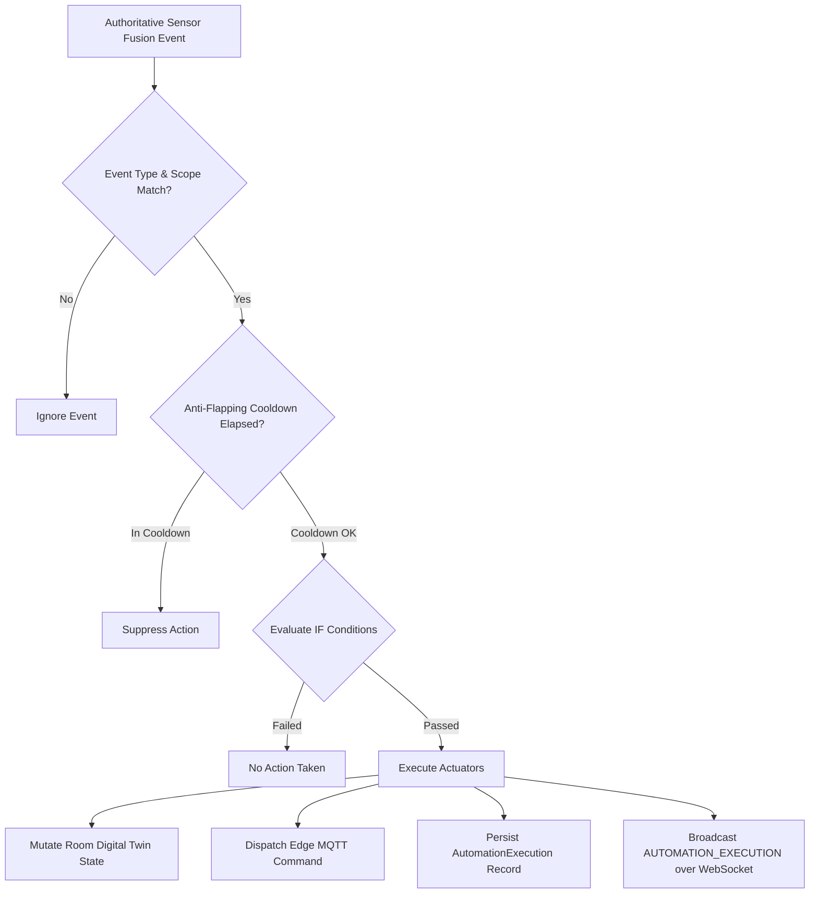

# SENTINEL — Day 10 Engineering Report
## Autonomous Policy Engine, Closed-Loop Actuator Control & Real-Time Auditing

---

### Executive Summary

On **Day 10**, the core mission statement of Sentinel — **"Sense → Understand → Decide → Act → Escalate only when necessary"** — was realized. Building directly on Day 9's Sensor Fusion and Event Engine, Day 10 delivers a production-grade **Autonomous Policy Engine** that evaluates spatial event telemetry, verifies conditional predicates, manages anti-flapping cooldown windows, and executes dual-mode actuations:
1. **Digital Twin Mutations**: Dynamic adjustments to physical facility state models (e.g. `RoomModel.hvacState: 'ECO' | 'COMFORT' | 'OFF' | 'VENTILATION_BOOST'`).
2. **Physical Edge Actuator Commands**: Low-latency MQTT command dispatch to edge microcontrollers (ESP32 / Raspberry Pi GPIO relays, buzzers, air dampers) via `MqttService.publishCommand`.

The complete Day 10 pipeline includes persistent execution audit trails, an interactive simulation sandbox, real-time WebSocket streaming of automated actions, and an enterprise web operations console at `/automations`.

---

### Key Deliverables

| Layer | Component | Description |
|---|---|---|
| **Core Types** | [`packages/types/src/automation.ts`](file:///e:/Sentinel/packages/types/src/automation.ts) | Strict TypeScript interfaces for `AutomationRule`, `AutomationExecution`, `ExecutedAction`, `CreateAutomationRuleDTO`, `UpdateAutomationRuleDTO`, `AutomationFilterQuery`, and `AutomationStats`. |
| **Validation** | [`packages/validation/src/schemas.ts`](file:///e:/Sentinel/packages/validation/src/schemas.ts) | Zod schemas ensuring runtime payload validation and type safety for rule creation, editing, filtering, and sandbox simulation. |
| **Data Models** | [`AutomationRule.ts`](file:///e:/Sentinel/apps/api/src/models/AutomationRule.ts) [`AutomationExecution.ts`](file:///e:/Sentinel/apps/api/src/models/AutomationExecution.ts) | MongoDB collections with compound spatial indices, anti-flapping cooldown tracking, and detailed execution audit trails. |
| **Actuator Service** | [`actuator.service.ts`](file:///e:/Sentinel/apps/api/src/services/actuator.service.ts) | Unified actuator execution dispatching digital twin mutations (`RoomModel`) and edge MQTT commands (`MqttService`). |
| **Automation Service** | [`automation.service.ts`](file:///e:/Sentinel/apps/api/src/services/automation.service.ts) | Authoritative policy engine listening to `eventBus`, evaluating condition predicates, enforcing anti-flapping cooldown, recording execution audits, and emitting to `automationBus`. |
| **REST Router** | [`automations.ts`](file:///e:/Sentinel/apps/api/src/routes/automations.ts) | Enterprise CRUD endpoints, quick toggle, simulation sandbox (`POST /test`), aggregate stats, and execution history. |
| **Real-Time Streaming** | [`websocket.service.ts`](file:///e:/Sentinel/apps/api/src/services/websocket.service.ts) | Broadcasts `{ type: 'AUTOMATION_EXECUTION', data }` packets with spatial filtering over `/ws/telemetry`. |
| **Web Context** | [`AutomationContext.tsx`](file:///e:/Sentinel/apps/web/src/context/AutomationContext.tsx) | React state provider managing live WebSocket updates, optimistic toggles, policy CRUD, and simulation tests. |
| **UI Components** | [`AutomationRuleCard.tsx`](file:///e:/Sentinel/apps/web/src/components/automations/AutomationRuleCard.tsx) [`CreateRuleModal.tsx`](file:///e:/Sentinel/apps/web/src/components/automations/CreateRuleModal.tsx) [`ExecutionLogDrawer.tsx`](file:///e:/Sentinel/apps/web/src/components/automations/ExecutionLogDrawer.tsx) [`SimulateAutomationModal.tsx`](file:///e:/Sentinel/apps/web/src/components/automations/SimulateAutomationModal.tsx) | Visual IF/THEN rule cards, no-code rule builder, real-time audit log stream, and interactive sandbox testing suite. |
| **Web Console** | [`AutomationsPage.tsx`](file:///e:/Sentinel/apps/web/src/pages/AutomationsPage.tsx) | Operations dashboard mounted at `/automations` with KPI metric cards, filters, and live telemetry connection status. |
| **Automated Testing** | [`scratch/test-day10.mjs`](file:///e:/Sentinel/scratch/test-day10.mjs) | End-to-end integration test suite verifying 6/6 core automation criteria. |

---

### Seeded Industry Policies

In compliance with Master Prompt Section 34 and Section 49, `AutomationService.seedDefaultRules` provides four standard enterprise policies:

1. **Vacancy Energy Setback**:
   - **Trigger**: `ROOM_VACANT` (Confidence $\ge$ 85%)
   - **Actions**: `HVAC_ECO` (simulated digital twin rollback) + `LIGHT_OFF`
   - **Cooldown**: 60 seconds
2. **High $\text{CO}_2$ Fresh Air Ventilation Boost**:
   - **Trigger**: `HIGH_CO2` (`inputSignals.co2Ppm` $\ge$ 1,400 ppm)
   - **Actions**: `VENTILATION_INCREASE` (speed: boost)
   - **Cooldown**: 120 seconds
3. **Occupancy Climate Pre-Conditioning**:
   - **Trigger**: `ROOM_OCCUPIED` (Confidence $\ge$ 80%)
   - **Actions**: `HVAC_COMFORT` + `LIGHT_ON`
   - **Cooldown**: 60 seconds
4. **School Bus Person-Left-Behind Emergency Alarm**:
   - **Trigger**: `PERSON_LEFT_BEHIND` (Confidence $\ge$ 90%)
   - **Actions**: `RELAY` (Pin 12 closed) + `BUZZER` (5,000ms siren) + `SEND_NOTIFICATION` (Priority: Urgent)
   - **Cooldown**: 30 seconds

---

### Quality & Verification Results

1. **Automated Integration Tests (`scratch/test-day10.mjs`)**:
   - `TEST 1`: Default policy seeding across organizations — **PASSED** (4/4 policies seeded).
   - `TEST 2`: Vacancy Energy Setback triggering and `RoomModel.hvacState = 'ECO'` transition — **PASSED**.
   - `TEST 3`: High $\text{CO}_2$ ventilation boost setpoint transition and MQTT dispatch — **PASSED** (`VENTILATION_BOOST`).
   - `TEST 4`: Anti-flapping cooldown suppressing rapid cyclic actuation — **PASSED** (0 duplicate executions).
   - `TEST 5`: REST API CRUD, toggle, simulation sandbox (`POST /test`), and stats aggregation — **PASSED**.
   - `TEST 6`: Real-time WebSocket streaming of `AUTOMATION_EXECUTION` packets — **PASSED**.
2. **Monorepo Build**:
   - `packages/types`: Compiled cleanly via `tsc`.
   - `packages/validation`: Compiled cleanly via `tsc`.
   - `apps/api`: Compiled cleanly via `tsc`.
   - `apps/web`: Production bundle built via `vite build` (0 errors).
3. **Code Quality**:
   - `npm run lint`: **0 errors, 0 warnings** across all packages and apps with strict `--max-warnings 0`.
