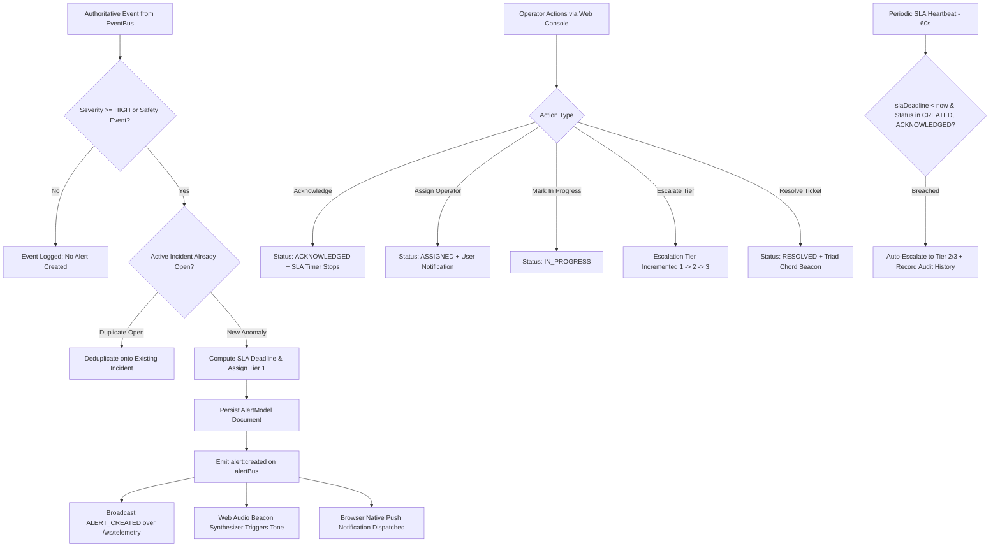

# SENTINEL — Day 11 Engineering Report
## Alerts, Incident Lifecycle, Audio Beacon Synthesizer & Multi-Tier SLA Escalation

---

### Executive Summary

On **Day 11**, the incident response pillar of Sentinel — **"Sense → Understand → Decide → Act → Escalate only when necessary"** — was brought to production completion. Operating hand-in-hand with the Autonomous Policy Engine (Day 10) and Sensor Fusion Engine (Day 9), Day 11 establishes a deterministic **Incident Management & SLA Escalation Architecture**:

1. **Automated Incident Generation & Deduplication**: High-priority safety events (`PERSON_LEFT_BEHIND`, `ASSISTANCE_INDICATION`, `HIGH_CO2`) emitted by the sensor fusion pipeline automatically spawn authoritative incident alerts with pre-calculated SLA deadlines, spatial digital twin breadcrumbs, and recommended operating procedures. High-frequency duplicate telemetry is seamlessly deduplicated to eliminate operator alert fatigue.
2. **Multi-Tier SLA Escalation Matrix (Tiers 1–3)**: Timed acknowledgement deadlines calibrated by severity (`CRITICAL`: 5m, `HIGH`: 15m, `WARNING`: 60m, `INFO`: 4h) with automated background heartbeat checks that escalate unacknowledged or breached incidents across escalation tiers with persistent audit logging.
3. **Hardware-Independent Web Audio Beacon Synthesizer**: Pure programmatic tone synthesis via the browser's Web Audio API (`AudioContext`, `OscillatorNode`, `GainNode`), generating distinct harmonic beacons (`CRITICAL`: 880Hz pulsating siren, `HIGH`: 659Hz double pip, `WARNING`: 523Hz single ping, `RESOLVED`: major triad chord) with zero external audio asset dependencies, volume controls, mute persistence, and 10s anti-flooding cooldowns.
4. **Native Browser Desktop Push**: Integration with browser `Notification` API with automatic permission gating, notification tag deduplication, and window-focus routing on click.
5. **Real-Time Streaming & Web Operations Console**: Real-time packet broadcasting over `/ws/telemetry` (`ALERT_CREATED`, `ALERT_UPDATED`, `ALERT_ESCALATED`, `ALERT_RESOLVED`) consumed by a dedicated Operations Console mounted at `/alerts` in `apps/web`.

---

### Architecture & System Overview

---

### Key Deliverables

| Layer | Component | Description |
|---|---|---|
| **Core Types** | [`packages/types/src/alert.ts`](file:///e:/Sentinel/packages/types/src/alert.ts) | Enhanced interfaces for `Alert`, `AlertHistoryEntry`, `CreateAlertDTO`, `UpdateAlertStatusDTO`, `EscalateAlertDTO`, `AlertFilterQuery`, and `AlertStats`. |
| **Validation** | [`packages/validation/src/schemas.ts`](file:///e:/Sentinel/packages/validation/src/schemas.ts) | Strict runtime Zod validation for incident payloads, status mutations, manual triage submissions, and filtering. |
| **Data Models** | [`Alert.ts`](file:///e:/Sentinel/apps/api/src/models/Alert.ts) | MongoDB collection with compound indices (`organizationId`, `severity`, `status`, `slaDeadline`), Tier 1 baseline default, and `toSafeAlert()`. |
| **Backend Service** | [`alert.service.ts`](file:///e:/Sentinel/apps/api/src/services/alert.service.ts) | Core incident management engine with automatic `eventBus` listener, anti-flooding deduplication, SLA calculation, lifecycle state transitions, periodic SLA heartbeat checker, and audit trail generation. |
| **Actuator Service** | [`actuator.service.ts`](file:///e:/Sentinel/apps/api/src/services/actuator.service.ts) | Integrated `CREATE_ALERT` and `ESCALATE_ALERT` action primitives directly with `AlertService`. |
| **REST API Router** | [`alerts.ts`](file:///e:/Sentinel/apps/api/src/routes/alerts.ts) | Full RESTful suite (`GET /stats`, `GET /`, `GET /:id`, `POST /`, `POST /:id/acknowledge`, `POST /:id/assign`, `POST /:id/status`, `POST /:id/escalate`, `POST /:id/resolve`). |
| **Real-Time Stream** | [`websocket.service.ts`](file:///e:/Sentinel/apps/api/src/services/websocket.service.ts) | Listens to `alertBus` and dispatches authenticated WebSocket packets over `/ws/telemetry`. |
| **Sound Engine** | [`soundEngine.ts`](file:///e:/Sentinel/apps/web/src/utils/soundEngine.ts) | Web Audio API synthesizer generating calibrated electronic beacons with zero audio file dependencies and 10s cooldown per incident. |
| **Notification Engine** | [`notificationEngine.ts`](file:///e:/Sentinel/apps/web/src/utils/notificationEngine.ts) | Native browser `Notification` integration with tag deduplication and window focus routing. |
| **Web Context** | [`AlertContext.tsx`](file:///e:/Sentinel/apps/web/src/context/AlertContext.tsx) | Global React context with real-time WebSocket packet synchronization, optimistic status updates, push dispatch, and sound trigger coordination. |
| **UI Components** | [`SoundControlBar.tsx`](file:///e:/Sentinel/apps/web/src/components/alerts/SoundControlBar.tsx) [`AlertCard.tsx`](file:///e:/Sentinel/apps/web/src/components/alerts/AlertCard.tsx) [`AlertDetailModal.tsx`](file:///e:/Sentinel/apps/web/src/components/alerts/AlertDetailModal.tsx) [`CreateAlertModal.tsx`](file:///e:/Sentinel/apps/web/src/components/alerts/CreateAlertModal.tsx) | Live audio synthesizer control bar, visual severity cards with dynamic SLA countdown timers & breach warnings, detailed sensor evidence modal with audit timeline, and manual triage submission dialog. |
| **Web Console** | [`AlertsPage.tsx`](file:///e:/Sentinel/apps/web/src/pages/AlertsPage.tsx) | Production operations console mounted at `/alerts` in [`App.tsx`](file:///e:/Sentinel/apps/web/src/App.tsx) replacing the placeholder route. |
| **Integration Suite** | [`scratch/test-day11.mjs`](file:///e:/Sentinel/scratch/test-day11.mjs) | 100% passing automated test suite verifying all 7 incident management criteria. |

---

### SLA Deadlines & Escalation Matrix

In strict accordance with Master Prompt Section 35:

| Severity | SLA Acknowledgment Window | Target Operating Procedure | Audio Synthesizer Profile |
|---|---|---|---|
| **CRITICAL** | **5 minutes** | Immediate physical operator dispatch (e.g. Unattended child / Fall detected) | 880Hz Pulsating Siren (`sawtooth` wave) |
| **HIGH** | **15 minutes** | Active environment triage (e.g. $\text{CO}_2 > 2,000$ ppm, Fire damper fault) | 659Hz Double Pip (`sine` wave) |
| **WARNING** | **60 minutes** | Facility maintenance ticket (e.g. Thermal comfort drift, Door propped open) | 523Hz Single Ping (`sine` wave) |
| **INFO** | **4 hours (240 min)** | Routine informational record / log validation | Subtle UI Toast (silent) |

---

### Quality & Verification Results

1. **Automated Integration Tests (`scratch/test-day11.mjs`)**:
   - `Test 1: Automated Incident Generation via EventBus`: **PASSED** (Critical alert generated from `PERSON_LEFT_BEHIND` with accurate 5m SLA deadline).
   - `Test 2: Anti-Flooding Deduplication`: **PASSED** (Subsequent duplicate high-frequency events merged without creating spam alerts).
   - `Test 3: Alert Lifecycle REST Mutations`: **PASSED** (`CREATED` $\rightarrow$ `ACKNOWLEDGED` $\rightarrow$ `ASSIGNED` $\rightarrow$ `IN_PROGRESS` $\rightarrow$ `ESCALATED` to Tier 2 $\rightarrow$ `RESOLVED`).
   - `Test 4: Manual Incident Creation via REST`: **PASSED** (`POST /api/v1/alerts` validated and created).
   - `Test 5: SLA Heartbeat Auto-Escalation`: **PASSED** (Breached alert past deadline automatically promoted to Tier 2 with SLA breach audit note).
   - `Test 6: Alert Stats & KPI Aggregation`: **PASSED** (Real-time active, critical, high, escalated, and resolved counters).
   - `Test 7: WebSocket Alert Stream Delivery`: **PASSED** (Delivered `ALERT_CREATED`, `ALERT_UPDATED`, `ALERT_ESCALATED`, and `ALERT_RESOLVED` packets over WebSocket).
2. **Monorepo Build**:
   - `npm run build`: **0 compilation errors** across all 5 workspace projects (`@sentinel/types`, `@sentinel/shared`, `@sentinel/validation`, `@sentinel/api`, `@sentinel/web`).
3. **Static Code Analysis**:
   - `npm run lint`: **0 errors, 0 warnings** across the monorepo with strict `--max-warnings 0`.
