# SENTINEL — Day 12 Engineering Report
## Analytics, Spatial Utilization, Environmental IEQ & ESG Digital Twin Engine

---

### Executive Summary

On **Day 12**, the foundational feedback loop of Sentinel — **"Sense → Understand → Decide → Act → Quantify Real-World Impact"** (Master Prompt Section 40, Section 44, Section 48 Day 12, and Section 49 MVP Boundary) — reached end-to-end operational maturity.

While previous days built real-time sensory ingestion (Days 1–8), Bayesian sensor fusion (Day 9), autonomous policy actuation (Day 10), and multi-tier incident escalation (Day 11), Day 12 closes the loop by quantifying the tangible physical, financial, and environmental impact of autonomous operations.

#### Core Capabilities Delivered:
1. **Epistemological Provenance Standard (Master Prompt Section 40)**:
   Rigorous architectural classification and visual demarcation distinguishing between:
   - `MEASURED`: Direct empirical hardware readings (e.g., raw $\text{CO}_2$ ppm, ambient temperature, relative humidity, dBA sound levels, Wi-Fi RSSI).
   - `ESTIMATED`: Values derived via sensor fusion models, room state estimators, and thermodynamic digital twins (e.g., occupant count, space utilization %, kWh conserved, carbon offset).
   - `PREDICTED`: Machine learning forward projections (e.g., 24-hour predictive peak load models).
2. **Spatial Utilization & Occupancy Intelligence**:
   Dynamic computation of space utilization rates, peak utilization hour identification, average occupants per active zone, 24-hour occupancy histograms, and spatial state distribution (`EMPTY`, `OCCUPIED`, `STATIONARY_OCCUPANCY`, `ACTIVE_OCCUPANCY`, `HIGH_DENSITY`).
3. **Environmental Quality (IEQ) & ASHRAE 55 Comfort Compliance**:
   Real-time and historical aggregation of $\text{CO}_2$ (average, peak, hazard hours $>1,400$ ppm), temperature, relative humidity, and acoustic sound levels, with an automated ASHRAE Standard 55 thermal comfort compliance gauge (20–24°C, 30–60% RH).
4. **ESG Energy Conservation & Carbon Offset Digital Twin**:
   A deterministic digital twin model that continuously tracks room setback hours (`HVAC_ECO`, `LIGHT_OFF`) and autonomous policy executions, computing:
   - **Energy Conserved**: $1.25\text{ kWh}$ net saving per setback hour (1.1 kW HVAC delta + 0.15 kW lighting reduction).
   - **Cost Reduction**: Calibrated against a standard commercial tariff ($0.14/\text{kWh}$).
   - **Grid Carbon Offset**: Calculated using standard EPA/grid emission factors ($0.42\text{ kg CO}_2\text{e}/\text{kWh}$).
   - **Efficiency Grading**: Categorization from `A+` ($\ge 90\%$) down to `D` ($<50\%$) based on the ratio of active setback hours to total vacant space hours.
5. **Incident SLA & Fleet Operational Reliability**:
   Aggregation of Mean Time to Acknowledge (MTTA), Mean Time to Resolve (MTTR), on-time SLA compliance percentages, multi-tier escalation distribution (Tiers 1–3), fleet node uptime, average Wi-Fi RSSI signal quality, and sensor catalog operational health.
6. **Operations Console Mounted at `/analytics`**:
   Full interactive web console with timeframe switching (`1h`, `24h`, `7d`, `30d`), facility scoping, responsive SVG histograms, interactive tooltips, and real-time refresh.

---

### System Architecture

```mermaid
graph TD
    subgraph Data Layer
        TM[(TelemetryModel)]
        RM[(RoomModel)]
        AM[(AlertModel)]
        EM[(AutomationExecutionModel)]
        DM[(DeviceModel)]
        SM[(SensorModel)]
    end

    subgraph Analytics Service
        AS[AnalyticsService]
        AS --> OPA[Occupancy & Spatial Analyzer]
        AS --> EQA[Environmental IEQ Analyzer]
        AS --> ESG[ESG Energy & Carbon Digital Twin]
        AS --> SLA[SLA & Escalation Performance Engine]
        AS --> FHA[Fleet & Sensor Health Matrix]
    end

    TM & RM --> OPA
    TM --> EQA
    RM & EM --> ESG
    AM --> SLA
    DM & SM --> FHA

    subgraph REST API Layer - /api/v1/analytics
        ROUTER[Analytics Router]
        ROUTER --> GET_OV[GET /overview]
        ROUTER --> GET_OCC[GET /occupancy]
        ROUTER --> GET_ENV[GET /environment]
        ROUTER --> GET_ESG[GET /esg]
        ROUTER --> GET_SLA[GET /sla]
        ROUTER --> GET_AUT[GET /automation]
        ROUTER --> GET_DEV[GET /devices]
    end

    AS --> ROUTER

    subgraph Web Operations Console - /analytics
        ACX[AnalyticsContext]
        ACX --> TS[TimeframeSelector]
        ACX --> PB[ProvenanceBadge System]
        ACX --> OTC[OccupancyTrendChart]
        ACX --> ETC[EnvironmentalTrendChart]
        ACX --> ESC[EsgSavingsCard & Twin]
        ACX --> SPC[SlaPerformanceCard]
        ACX --> DHM[DeviceHealthMatrix]
    end

    ROUTER --> ACX
```

---

### Key Deliverables

| Layer | Component | Description |
|---|---|---|
| **Core Types** | [`packages/types/src/analytics.ts`](file:///e:/Sentinel/packages/types/src/analytics.ts) | Strict TypeScript interfaces for `OccupancyAnalytics`, `EnvironmentalAnalytics`, `EsgEnergyAnalytics`, `SlaIncidentAnalytics`, `AutomationPerformanceAnalytics`, `DeviceFleetAnalytics`, `AnalyticsOverview`, `MetricProvenance`, and `AnalyticsFilterQuery`. |
| **Validation** | [`packages/validation/src/schemas.ts`](file:///e:/Sentinel/packages/validation/src/schemas.ts) | Zod schemas: `analyticsTimeframeSchema`, `analyticsIntervalSchema`, and `analyticsFilterSchema`. |
| **Backend Service** | [`analytics.service.ts`](file:///e:/Sentinel/apps/api/src/services/analytics.service.ts) | Aggregation engine implementing spatial utilization formulas, ASHRAE 55 thermal comfort compliance, ESG energy/carbon setback digital twin equations, SLA MTTA/MTTR response timers, and device fleet availability. |
| **REST API Router** | [`analytics.ts`](file:///e:/Sentinel/apps/api/src/routes/analytics.ts) | Fully secured REST router mounted at `/api/v1/analytics` with `requireAuth` and `requirePermission('analytics.read')`, exposing 7 domain endpoints. |
| **Web Context** | [`AnalyticsContext.tsx`](file:///e:/Sentinel/apps/web/src/context/AnalyticsContext.tsx) | React state provider managing timeframe filters (`1h`, `24h`, `7d`, `30d`), facility selection, caching, live refetching, and error handling. |
| **Provenance UI** | [`ProvenanceBadge.tsx`](file:///e:/Sentinel/apps/web/src/components/analytics/ProvenanceBadge.tsx) | Epistemological visual badges (`MEASURED`, `ESTIMATED`, `PREDICTED`) with color-coded tokens and explanatory tooltips per Master Prompt Section 40. |
| **Timeframe Filter** | [`TimeframeSelector.tsx`](file:///e:/Sentinel/apps/web/src/components/analytics/TimeframeSelector.tsx) | Quick timeframe picker and facility dropdown for scoping facility-wide or organization-wide analytics. |
| **ESG Digital Twin Card** | [`EsgSavingsCard.tsx`](file:///e:/Sentinel/apps/web/src/components/analytics/EsgSavingsCard.tsx) | High-impact ESG dashboard displaying total kWh saved, estimated cost savings ($), carbon offset ($\text{kg CO}_2\text{e}$), efficiency grade badge (`A+`–`D`), and stacked HVAC state distribution bar (`ECO`, `COMFORT`, `VENTILATION_BOOST`, `OFF`). |
| **Spatial Trend Chart** | [`OccupancyTrendChart.tsx`](file:///e:/Sentinel/apps/web/src/components/analytics/OccupancyTrendChart.tsx) | Space utilization rate dial, peak load hour banner, 24-hour occupancy histogram with hover tooltips, and spatial room state breakdown. |
| **IEQ Trend Chart** | [`EnvironmentalTrendChart.tsx`](file:///e:/Sentinel/apps/web/src/components/analytics/EnvironmentalTrendChart.tsx) | ASHRAE 55 thermal comfort compliance gauge, average & peak $\text{CO}_2$ cards, and dynamic $\text{CO}_2$ time-series chart with 1,000 ppm standard and 1,400 ppm hazard threshold lines. |
| **SLA Response Card** | [`SlaPerformanceCard.tsx`](file:///e:/Sentinel/apps/web/src/components/analytics/SlaPerformanceCard.tsx) | MTTA and MTTR dials, on-time SLA compliance percentage, incident severity breakdown, and multi-tier escalation distribution. |
| **Device Health Matrix** | [`DeviceHealthMatrix.tsx`](file:///e:/Sentinel/apps/web/src/components/analytics/DeviceHealthMatrix.tsx) | Fleet availability dial, online ESP32 node count, average Wi-Fi RSSI signal quality indicator, and sensor catalog operational health bar. |
| **Web Console Page** | [`AnalyticsPage.tsx`](file:///e:/Sentinel/apps/web/src/pages/AnalyticsPage.tsx) | Production-ready Operations Console mounting all analytics views, mounted in `App.tsx` at `/analytics`. |

---

### Engineering Formulas & Standards Applied

#### 1. ESG Energy & Carbon Setback Digital Twin Model
- **HVAC Comfort vs Setback Delta**: Commercial HVAC draws $\sim 1.8\text{ kW}$ in comfort conditioning and $\sim 0.7\text{ kW}$ in setback (`HVAC_ECO`), yielding a net saving of $1.1\text{ kW/h}$.
- **Lighting Reduction**: Automated vacancy switch-off saves $0.15\text{ kW/h}$.
- **Total Conservative Energy Delta**:
  $$\Delta P = 1.25\text{ kWh per room setback hour}$$
- **Carbon Offset & Cost Savings Equations**:
  $$\text{Energy Conserved (kWh)} = N_{\text{setback\_hours}} \times 1.25\text{ kWh}$$
  $$\text{Financial Savings (\$)} = \text{kWh} \times \$0.14/\text{kWh}$$
  $$\text{Carbon Offset (kg CO}_2\text{e)} = \text{kWh} \times 0.42\text{ kg CO}_2\text{e/kWh}$$
- **Digital Twin Efficiency Rating**:
  - $\ge 90\%$ Setback Ratio: **A+**
  - $\ge 80\%$: **A**
  - $\ge 70\%$: **B**
  - $\ge 60\%$: **C**
  - $< 60\%$: **D**

#### 2. ASHRAE Standard 55 Thermal Comfort Compliance
A sample is classified as compliant if and only if:
$$20.0^\circ\text{C} \le T \le 24.0^\circ\text{C} \quad \text{AND} \quad 30.0\% \le RH \le 60.0\%$$
$$\text{Compliance Rate (\%)} = \left(\frac{N_{\text{compliant}}}{N_{\text{total}}}\right) \times 100$$

#### 3. Epistemological Data Provenance (Master Prompt Section 40)
Every metric displayed in Sentinel carries an explicit provenance tag:
- **`MEASURED`**: Raw sensor inputs ($\text{CO}_2$, Temp, Humidity, Sound dB, Wi-Fi RSSI).
- **`ESTIMATED`**: Derived/fused models (Occupancy headcount, space utilization %, energy conserved, carbon offset).
- **`PREDICTED`**: Forward projections (Future load forecasts).

---

### Quality Assurance & Verification Results

1. **Automated Integration Test Suite (`scratch/test-day12.mjs`)**:
   - **Test 1**: Occupancy & Spatial Utilization Analytics (`ESTIMATED`) — **PASSED** (78% utilization, 1.7 avg occupants, peak hour 05:00).
   - **Test 2**: Environmental Quality & Thermal Comfort Analytics (`MEASURED`) — **PASSED** (680 ppm avg $\text{CO}_2$, 810 ppm peak $\text{CO}_2$, 100% ASHRAE comfort compliance).
   - **Test 3**: ESG Energy & Carbon Setback Digital Twin (`ESTIMATED`) — **PASSED** (90 kWh saved, $12.60 financial savings, 37.8 kg $\text{CO}_2\text{e}$ offset, B rating).
   - **Test 4**: SLA Incident Response & Escalation Matrix Analytics (`MEASURED`) — **PASSED** (1.5 min MTTA, 6 min MTTR, 100% SLA compliance).
   - **Test 5**: Device Fleet & Sensor Catalog Health (`MEASURED`) — **PASSED** (67% uptime, -58 dBm RSSI, 37 active sensors).
   - **Test 6**: REST API Analytics Endpoints — **PASSED** (all 7 endpoints responded with HTTP 200).
2. **Monorepo Build**:
   - `npm run build` completed with **exit code 0** across all 5 workspace projects (`@sentinel/types`, `@sentinel/shared`, `@sentinel/validation`, `@sentinel/api`, and `@sentinel/web`).
3. **Lint Verification**:
   - `npm run lint` completed with **exit code 0** (0 errors, 0 warnings with `--max-warnings 0`).
