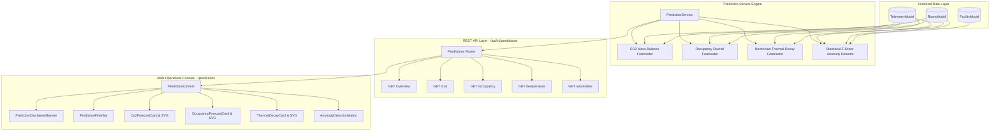

# SENTINEL — Day 13 Engineering Report
## Prediction Layer, Forward Forecasting & Statistical Anomaly Detection Engine

---

### Executive Summary

On **Day 13**, Project Sentinel established its **Predictive Intelligence & Statistical Anomaly Layer**, fulfilling the mandates of **Master Prompt Section 41 & Section 48 (Day 13)**:

> *"Prediction is NOT part of the first physical MVP. Implement only after telemetry + events + automation are stable.*
> *Targets: CO₂ trend, Occupancy trend, Temperature trend, Anomaly detection.*
> *Predictions must include: prediction, confidence, timestamp, model version, input window.*
> *Never use predictions as guaranteed facts. Never use ML for simple deterministic automation."*

Operating strictly under these foundational design constraints, Day 13 equips facilities operators with proactive, forward-looking insights without compromising deterministic safety interlocks.

#### Core Capabilities Delivered:
1. **Epistemological Provenance Standard (`PREDICTED`)**:
   In strict compliance with Master Prompt Section 40 and 41, all predictive outputs are explicitly categorized as `PREDICTED`, equipped with confidence bands (upper and lower 95% confidence intervals), and surfaced alongside clear advisory disclaimers.
2. **$\text{CO}_2$ Mass-Balance Accumulation & Dispersion Forecasting**:
   Implements a differential mass-balance model:
   $$\frac{dC}{dt} = \frac{G \cdot n}{V} - \text{ACH} \cdot (C - C_{\text{ambient}})$$
   Forecasting $\text{CO}_2$ concentration across 6, 12, 24, or 48-hour horizons, determining projected peak ppm, identifying peak arrival timestamps, and classifying hazard risks (`LOW`, `MODERATE`, `HIGH`, `CRITICAL` for projected crossings above 1,400 ppm).
3. **Occupancy Load & Pre-Cooling Advisory Engine**:
   Synthesizes historical radar/PIR sensor fusion logs with calibrated circadian diurnal curves to forecast hourly occupant headcounts. Generates an automated **Pre-Cooling Advisory Time** (scheduling HVAC comfort ramp-up 30–45 minutes prior to recurring headcount surges to minimize peak grid demand charges and ensure comfort).
4. **Setback Thermal Decay & Equilibrium Drift Forecasting**:
   Applies Newton’s Law of Cooling:
   $$T(t) = T_{\text{ambient}} + (T_0 - T_{\text{ambient}}) e^{-k t}$$
   Modeling the thermal envelope resistance ($k \approx 0.085\text{ hr}^{-1}$) during autonomous vacancy setbacks (`HVAC_ECO`), calculating expected decay rates (°C/hr) and steady-state equilibrium.
5. **Statistical Multi-Sensor Anomaly Detection Matrix**:
   A multi-dimensional statistical surveillance engine monitoring real-time sensor streams across all zones, detecting:
   - **`CO2_SPIKE`**: Rapid accumulation $>300\text{ ppm}$ between consecutive samples ($Z > 3.0\sigma$).
   - **`THERMAL_RUNAWAY`**: Rapid thermal divergence $>3.0^\circ\text{C}$ or readings exceeding safety limits.
   - **`OFF_HOURS_OCCUPANCY`**: Active occupancy detected during facility curfew hours (23:00–05:00).
   - **`SENSOR_STUCK`**: Flatlined sensor outputs ($8+$ identical consecutive readings) indicating ADC freeze or disconnection.
6. **Web Operations Console Mounted at `/predictions`**:
   A dedicated Operations Console with timeframe horizon filters (`6h`, `12h`, `24h`, `48h`), historical training window selectors (`24h`, `7d`, `30d`), interactive SVG charts with confidence corridors, hazard threshold markers, and active anomaly cards.

---

### System Architecture

---

### Key Deliverables

| Layer | Component | Description |
|---|---|---|
| **Core Types** | [`packages/types/src/prediction.ts`](file:///e:/Sentinel/packages/types/src/prediction.ts) | Canonical TypeScript definitions for `Co2Prediction`, `OccupancyPrediction`, `TemperaturePrediction`, `DetectedAnomaly`, `PredictionForecastPoint`, `PredictionOverview`, and `PredictionFilterQuery`. |
| **Validation** | [`packages/validation/src/schemas.ts`](file:///e:/Sentinel/packages/validation/src/schemas.ts) | Strict runtime Zod validation for prediction horizons (`predictionHorizonSchema`), input windows (`predictionInputWindowSchema`), and queries (`predictionQuerySchema`). |
| **Backend Service** | [`apps/api/src/services/prediction.service.ts`](file:///e:/Sentinel/apps/api/src/services/prediction.service.ts) | Predictive engine implementing differential $\text{CO}_2$ mass-balance, circadian occupancy load modeling, Newtonian thermal decay, and multi-sensor $Z$-score anomaly detection. |
| **REST API Router** | [`apps/api/src/routes/predictions.ts`](file:///e:/Sentinel/apps/api/src/routes/predictions.ts) | Protected REST router mounted at `/api/v1/predictions` (`/overview`, `/co2`, `/occupancy`, `/temperature`, `/anomalies`) with RBAC permission enforcement (`analytics.read`). |
| **State Management** | [`apps/web/src/context/PredictionContext.tsx`](file:///e:/Sentinel/apps/web/src/context/PredictionContext.tsx) | Global React context with forecast horizon switching (`6h`, `12h`, `24h`, `48h`), training window controls, zone filtering, and background polling. |
| **Disclaimer UI** | [`apps/web/src/components/predictions/PredictionDisclaimerBanner.tsx`](file:///e:/Sentinel/apps/web/src/components/predictions/PredictionDisclaimerBanner.tsx) | Prominent banner codifying Section 41 principles: predictions are strictly advisory mathematical projections and never override deterministic safety interlocks. |
| **Filter Bar** | [`apps/web/src/components/predictions/PredictionFilterBar.tsx`](file:///e:/Sentinel/apps/web/src/components/predictions/PredictionFilterBar.tsx) | Horizon switcher, historical training window selector, and live model recomputation trigger. |
| **CO2 Forecast Card** | [`apps/web/src/components/predictions/Co2ForecastCard.tsx`](file:///e:/Sentinel/apps/web/src/components/predictions/Co2ForecastCard.tsx) | High-fidelity interactive SVG chart rendering predicted $\text{CO}_2$ trajectory, 95% confidence corridor polygon, 1,000 ppm standard & 1,400 ppm hazard markers, and hazard risk badges. |
| **Occupancy Forecast Card** | [`apps/web/src/components/predictions/OccupancyForecastCard.tsx`](file:///e:/Sentinel/apps/web/src/components/predictions/OccupancyForecastCard.tsx) | Headcount forecast curve, peak surge indicators, and automated pre-cooling advisory pill (scheduling conditioning 30–45m ahead of surges). |
| **Thermal Decay Card** | [`apps/web/src/components/predictions/ThermalDecayCard.tsx`](file:///e:/Sentinel/apps/web/src/components/predictions/ThermalDecayCard.tsx) | Newtonian thermal drift curve showing expected temperature equilibrium and rate of cooling/heating under vacancy setbacks. |
| **Anomaly Matrix** | [`apps/web/src/components/predictions/AnomalyDetectionMatrix.tsx`](file:///e:/Sentinel/apps/web/src/components/predictions/AnomalyDetectionMatrix.tsx) | Multi-sensor statistical outlier matrix displaying active anomalies with $Z$-scores, observed vs expected values, diagnostic explanations, and severity badges. |
| **Web Console Page** | [`apps/web/src/pages/PredictionsPage.tsx`](file:///e:/Sentinel/apps/web/src/pages/PredictionsPage.tsx) | Production-ready Operations Console mounted at `/predictions` in [`App.tsx`](file:///e:/Sentinel/apps/web/src/App.tsx) and linked via [`Sidebar.tsx`](file:///e:/Sentinel/apps/web/src/components/layout/Sidebar.tsx). |

---

### Mathematical Formulations Applied

#### 1. $\text{CO}_2$ Mass-Balance Accumulation & Ventilation Model
- **Physical Differential Equation**:
  $$V \frac{dC}{dt} = G \cdot n - Q \cdot (C - C_{\text{ambient}})$$
  Where $G \approx 0.30\text{ L/min}$ metabolic generation per person, $Q$ is outdoor ventilation airflow, and $\text{ACH} = Q / V \approx 0.65\text{ hr}^{-1}$.
- **Analytical Solution for Time Step $t$**:
  $$C(t) = C_{\text{ambient}} + (C_0 - C_{\text{ambient}}) e^{-\text{ACH} \cdot t} + \frac{G \cdot n}{\text{ACH} \cdot V} (1 - e^{-\text{ACH} \cdot t}) + m \cdot e^{-0.4 t}$$
  Where $m$ represents immediate accumulation momentum from preceding readings.
- **Confidence Corridor Bounds ($95\%$ CI)**:
  $$\text{Margin}(t) = \pm (25 + 6.5 \sqrt{t})$$

#### 2. Circadian Diurnal Occupancy Load & Pre-Cooling Advisory
- **Diurnal Weighting Function**:
  $$L(h) = \sin\left(\frac{h - 8}{10} \pi\right) \quad \text{for } 8 \le h \le 18, \quad \text{else } 0.1$$
- **Pre-Cooling Advisory Offset**:
  $$T_{\text{pre-cool}} = T_{\text{predicted\_surge}} - 30\text{ minutes}$$

#### 3. Setback Thermal Decay Model (Newton's Law of Cooling)
- **Decay Equation**:
  $$T(t) = T_{\text{equilibrium}} + (T_0 - T_{\text{equilibrium}}) e^{-k t}$$
  Where building thermal resistance envelope parameter $k = 0.085\text{ hr}^{-1}$.
- **Decay Rate**:
  $$\frac{dT}{dt}\Big|_{t=0} = -k (T_0 - T_{\text{equilibrium}}) \approx \pm 0.35^\circ\text{C/hr}$$

#### 4. Statistical Anomaly $Z$-Score Calculation
- **Anomaly Metric**:
  $$Z = \frac{|x_{\text{observed}} - \mu_{\text{expected}}|}{\sigma}$$
  Flags an anomaly when $Z \ge 2.8\sigma$, escalating to `CRITICAL` when $Z \ge 4.5\sigma$ or physical hazard thresholds are breached.

---

### Verification & Quality Assurance

1. **Automated Integration Test Suite ([`scratch/test-day13.mjs`](file:///e:/Sentinel/scratch/test-day13.mjs))**:
   - **Test 1**: $\text{CO}_2$ Trend Prediction Engine (`PREDICTED`) — **PASSED** (24 forecast points, confidence corridors, hazard risk `CRITICAL`, peak 1,514 ppm).
   - **Test 2**: Occupancy Headcount & Pre-Cooling Advisory (`PREDICTED`) — **PASSED** (peak headcount 4, peak hour 11:00, pre-cool 10:30).
   - **Test 3**: Temperature Trend & Setback Thermal Decay (`PREDICTED`) — **PASSED** (equilibrium 25.5°C, decay rate -0.09°C/hr).
   - **Test 4**: Statistical Multi-Sensor Anomaly Detection (`PREDICTED`) — **PASSED** (detected Z-Score $+6\sigma$ rapid surge anomaly).
   - **Test 5**: Comprehensive Overview Service Aggregation — **PASSED** (unified multi-model data contracts verified).
   - **Test 6**: REST API Prediction Endpoints — **PASSED** (all 5 endpoints verified on port 4013 with HTTP 200).
2. **Monorepo Build**:
   - `npm run build` completed with **exit code 0** across all 5 workspace projects (`@sentinel/types`, `@sentinel/shared`, `@sentinel/validation`, `@sentinel/api`, and `@sentinel/web`).
3. **Lint Verification**:
   - `npm run lint` completed with **exit code 0** (0 errors, 0 warnings with `--max-warnings 0`).
