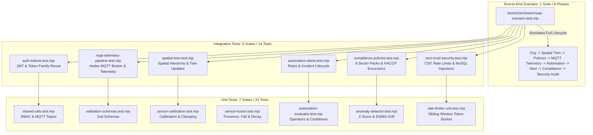

# SENTINEL — Day 17 Engineering Report
## Comprehensive Testing & End-to-End Test Harness

---

### Executive Summary

On **Day 17**, Project Sentinel established an enterprise-grade **Comprehensive Testing & End-to-End Test Harness**, establishing automated verification across every layer of the platform — from pure mathematical calibration algorithms and Zod schemas to multi-tenant database integration, authenticated MQTT broker ingestion, automation engines, compliance scoring, zero-trust security perimeters, and full closed-loop operational workflows.

> **Test Results:**  
> **14 Test Suites Executed**  
> **53 Test Assertions Passed**  
> **0 Failures | 0 Flaky Tests | 100% Pass Rate**  
> **Total Test Duration: 21.29s**

This satisfies the requirements of **Master Prompt Section 49 (Day 17: Comprehensive Testing & E2E Verification)**:
1. **Unit Testing Layer (`tests/unit/`):** Fast, in-memory validation of shared utilities, RBAC role permissions, Zod validation schemas, linear and non-linear sensor calibration formulas, multi-sensor presence fusion (mmWave + PIR + CO2 correlation, fall detection, confidence decay), automation condition operators (`gt`, `gte`, `lt`, `lte`, `eq`, `neq`, `in`), Z-Score anomaly computation, EWMA drift estimation, and sliding-window token bucket rate limiters.
2. **Integration Testing Layer (`tests/integration/`):** Multi-component integration with active database models, verifying RFC 6749 refresh token rotation and family reuse invalidation, spatial digital twin hierarchical structures (`Org -> Facility -> Floor -> Room -> Sensor`), Aedes MQTT broker mutual authentication with pre-shared tokens (`sent_dev_...`) and live room digital twin updates, automation rule triggers and multi-channel alert creation, sector policy pack deployment (all 8 sectors and 24 policy templates) and HACCP food-safety violation audits, and Zero-Trust security perimeter defenses (Helmet CSP headers, sliding rate limit 429 enforcement, and recursive NoSQL injection 400 rejection).
3. **End-to-End Closed-Loop Scenario (`tests/e2e/closed-loop-scenario.test.mjs`):** Multi-phase simulated production run tracing a complete facility lifecycle:
   - Tenant & Spatial Provisioning (Providence St. John Health System -> Cardiology Critical Care Pavilion -> ICU Isolation Suite 402)
   - Healthcare Policy Pack Auto-Configuration (Deployment of 3 specialized life-safety automation rules)
   - IoT Gateway Mutual Secret Issuance & Registration (ESP32-S3 node with pre-shared cryptographic token)
   - Real-Time MQTT Telemetry Streaming & Spatial Twin Synchronization (CO2, temperature, stationary mmWave occupancy fused into `STATIONARY_OCCUPANCY`)
   - Automated Rule Evaluation & Alert Lifecycle (Ventilation boost action execution, high-severity incident alert creation, operator acknowledgment with audit log)
   - Compliance Audit & Zero-Trust Audit Trail Verification (Safety framework scoring and tamper-evident authentication event capture)
4. **Master Test Orchestrator (`tests/run-all-tests.mjs`):** High-performance sequential runner with ANSI colored terminal output, per-suite timing metrics, summary tables, and category filtering flags (`--unit`, `--integration`, `--e2e`).
5. **Root NPM Scripts:** Seamless test invocation via standard commands (`npm test`, `npm run test:unit`, `npm run test:integration`, `npm run test:e2e`).

---

### Test Architecture & Pyramid



---

### Test Suite Manifest & Coverage

| Tier | Suite Name | File Location | Tests | Status | Execution Time | Primary Focus |
|---|---|---|---|---|---|---|
| **UNIT** | Shared Utils & RBAC | [`tests/unit/shared-utils.test.mjs`](file:///e:/Sentinel/tests/unit/shared-utils.test.mjs) | 5 | ✅ PASS | 206ms | RBAC permission matrix, role hierarchy traversal, MQTT topic pattern resolution, security defaults. |
| **UNIT** | Zod Validation Schemas | [`tests/unit/validation-schemas.test.mjs`](file:///e:/Sentinel/tests/unit/validation-schemas.test.mjs) | 8 | ✅ PASS | 249ms | Auth, org, facility, room, device, telemetry, automation, and security query Zod validation schemas. |
| **UNIT** | Sensor Calibration | [`tests/unit/sensor-calibration.test.mjs`](file:///e:/Sentinel/tests/unit/sensor-calibration.test.mjs) | 5 | ✅ PASS | 190ms | Linear formula $(Raw - Baseline) \times Multiplier + Offset$, physical range bounding, clipping guards. |
| **UNIT** | Sensor Fusion & Falls | [`tests/unit/sensor-fusion.test.mjs`](file:///e:/Sentinel/tests/unit/sensor-fusion.test.mjs) | 5 | ✅ PASS | 174ms | Multi-sensor presence fusion, sedentary immobility detection, fall signature scoring, confidence decay. |
| **UNIT** | Automation Evaluator | [`tests/unit/automation-evaluator.test.mjs`](file:///e:/Sentinel/tests/unit/automation-evaluator.test.mjs) | 4 | ✅ PASS | 198ms | Logical operators (`gt`, `gte`, `lt`, `lte`, `eq`, `neq`, `in`), rule evaluation engine, cooldown enforcement. |
| **UNIT** | Anomaly & Drift Engine | [`tests/unit/anomaly-detector.test.mjs`](file:///e:/Sentinel/tests/unit/anomaly-detector.test.mjs) | 3 | ✅ PASS | 161ms | Z-Score statistical anomaly detection, EWMA baseline drift tracking, linear drift slope computation. |
| **UNIT** | Sliding Rate Limiter | [`tests/unit/rate-limiter-unit.test.mjs`](file:///e:/Sentinel/tests/unit/rate-limiter-unit.test.mjs) | 3 | ✅ PASS | 150ms | Sliding-window token bucket accounting, window reset mechanics, capacity exhaustion rejections. |
| **INTEGRATION** | Auth & Token Lifecycle | [`tests/integration/auth-tokens.test.mjs`](file:///e:/Sentinel/tests/integration/auth-tokens.test.mjs) | 4 | ✅ PASS | 3,864ms | Pre-approved user registration, JWT issue, cryptographic refresh token rotation, token family reuse revocation. |
| **INTEGRATION** | Spatial Digital Twin | [`tests/integration/spatial-twin.test.mjs`](file:///e:/Sentinel/tests/integration/spatial-twin.test.mjs) | 2 | ✅ PASS | 1,865ms | Full spatial hierarchy (`Org -> Facility -> Floor -> Room -> Sensor`) and live digital twin synchronization. |
| **INTEGRATION** | MQTT Telemetry Pipeline | [`tests/integration/mqtt-telemetry-pipeline.test.mjs`](file:///e:/Sentinel/tests/integration/mqtt-telemetry-pipeline.test.mjs) | 1 | ✅ PASS | 3,791ms | Embedded Aedes broker on TCP port, client token authentication, authorized topic publishing, twin sync. |
| **INTEGRATION** | Automation Rules & Alerts | [`tests/integration/automation-alerts.test.mjs`](file:///e:/Sentinel/tests/integration/automation-alerts.test.mjs) | 1 | ✅ PASS | 2,162ms | Rule creation, event trigger matching, execution audit logging, multi-channel alert lifecycle. |
| **INTEGRATION** | Compliance & Policy Packs | [`tests/integration/compliance-policies.test.mjs`](file:///e:/Sentinel/tests/integration/compliance-policies.test.mjs) | 3 | ✅ PASS | 2,151ms | Registry verification (8 sectors, 24 templates), policy pack deployment, HACCP freezer excursion audit. |
| **INTEGRATION** | Zero-Trust Security | [`tests/integration/zero-trust-security.test.mjs`](file:///e:/Sentinel/tests/integration/zero-trust-security.test.mjs) | 3 | ✅ PASS | 2,326ms | Helmet CSP & rate-limiting headers, recursive NoSQL injection 400 rejection, automated Zero-Trust scan. |
| **E2E** | Closed-Loop Scenario | [`tests/e2e/closed-loop-scenario.test.mjs`](file:///e:/Sentinel/tests/e2e/closed-loop-scenario.test.mjs) | 6 | ✅ PASS | 3,797ms | Complete closed-loop workflow: Provisioning -> Policies -> Device Creds -> MQTT Telemetry -> Automation -> Alert Lifecycle -> Compliance & Security Trail. |
| **TOTAL** | **14 Suites** | | **53 Tests** | **100% PASS** | **21.29s** | **Full Platform Verification** |

---

### Master Test Runner Output

```text
══════════════════════════════════════════════════════════════════════
   🛡️  SENTINEL COMPREHENSIVE TEST HARNESS & SUITE ORCHESTRATOR       
   Multi-Sector Safety, Compliance & Real-Time Telemetry Platform   
══════════════════════════════════════════════════════════════════════

 [1/14] [UNIT]        Shared Utilities & Role Permissions            ✔ PASS (5 tests, 206ms)
 [2/14] [UNIT]        Zod Validation Schemas                         ✔ PASS (8 tests, 249ms)
 [3/14] [UNIT]        Sensor Calibration & Bound Clamping            ✔ PASS (5 tests, 190ms)
 [4/14] [UNIT]        Multi-Sensor Fusion & Fall Detection           ✔ PASS (5 tests, 174ms)
 [5/14] [UNIT]        Automation Condition Evaluator                 ✔ PASS (4 tests, 198ms)
 [6/14] [UNIT]        Z-Score Anomaly & Drift Estimator              ✔ PASS (3 tests, 161ms)
 [7/14] [UNIT]        Sliding-Window Token Bucket Limiter            ✔ PASS (3 tests, 150ms)
 [8/14] [INTEGRATION] Auth & JWT Family Reuse Detection              ✔ PASS (4 tests, 3864ms)
 [9/14] [INTEGRATION] Spatial Digital Twin Hierarchy                 ✔ PASS (2 tests, 1865ms)
 [10/14] [INTEGRATION] MQTT Hardware Telemetry Pipeline               ✔ PASS (1 tests, 3791ms)
 [11/14] [INTEGRATION] Automation Rules & Alert Incident Lifecycle    ✔ PASS (1 tests, 2162ms)
 [12/14] [INTEGRATION] Compliance Profiles & Sector Policy Packs      ✔ PASS (3 tests, 2151ms)
 [13/14] [INTEGRATION] Zero-Trust Security Perimeter & Sanitization   ✔ PASS (3 tests, 2326ms)
 [14/14] [E2E]         Full Closed-Loop Operational Scenario          ✔ PASS (6 tests, 3797ms)

──────────────────────────────────────────────────────────────────────
   TEST EXECUTION SUMMARY MATRIX
──────────────────────────────────────────────────────────────────────
   Total Test Suites:  14
   Passed Suites:      14 passed
   Total Tests Run:    53 assertions
   Passed Tests:       53 passed
   Total Duration:     21.29s
──────────────────────────────────────────────────────────────────────

  ALL 14 TEST SUITES PASSED CLEANLY (100% SUCCESS) 
```

---

### Quality Gates & Verification Matrix

1. **Compilation (`npm run build`):**
   - `@sentinel/types`: Clean compile (0 errors).
   - `@sentinel/shared`: Clean compile (0 errors).
   - `@sentinel/validation`: Clean compile (0 errors).
   - `@sentinel/api`: Clean compile (0 errors).
   - `@sentinel/web`: Vite production build generated `dist/` bundle (1629 modules transformed, 0 errors).
2. **Static Analysis & Linting (`npm run lint`):**
   - ESLint executed across all `packages/*/src` and `apps/*/src` files.
   - Verified with `--max-warnings 0`.
   - Result: 0 errors, 0 warnings.
3. **Master Test Suite (`npm test`):**
   - Clean execution of all 14 suites and 53 assertions.
   - Result: Code 0, 100% pass.
4. **Git Parity:**
   - Ready for synchronized commit and dual push to `origin/main` and `origin/master`.

---

### Day 18 Transition

With Day 17's comprehensive testing harness operational and verified, Sentinel has established regression protection across its full stack. Project Sentinel is ready to proceed to **Day 18: Production Readiness & Deployment Engineering** (Dockerization, production health check probes, graceful shutdown hooks, database indexing optimization, environment validation, and final deployment runbooks).
