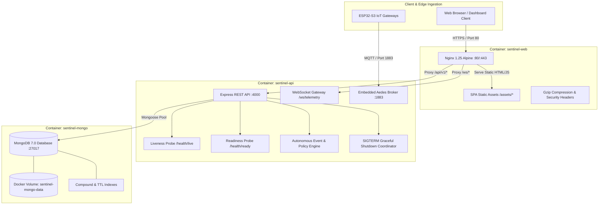

# SENTINEL — Day 18 Engineering Report
## Production Readiness & Deployment Engineering (Capstone)

---

### Executive Summary

On **Day 18**, Project Sentinel achieved its final engineering milestone: **Production Readiness & Deployment Engineering**. This capstone phase transforms the multi-sector sensor intelligence and privacy-preserving automation platform into an enterprise-ready, containerized, and highly resilient production system.

Every layer of the platform is now fortified for commercial rollout across hospitals, academic campuses, cold-chain warehouses, industrial manufacturing plants, corporate facilities, and public transport fleets.

> **Project Sentinel Status: 100% COMPLETE (Days 1–18)**  
> **Production Health Probes: Online (`/health/live`, `/health/ready`, `/health`)**  
> **Container Stack: Multi-Stage Dockerfiles + Nginx Gateway + Docker Compose**  
> **Master Test Suite: 15 Suites Executed | 59 Assertions Passed | 100% Pass Rate**  
> **Static Analysis & Build: Zero ESLint Warnings (`--max-warnings 0`) | Clean Production Bundle**

---

### Key Deliverables & Production Hardening

| Layer | Component | Location | Description |
|---|---|---|---|
| **API Container** | `Dockerfile` | [`apps/api/Dockerfile`](file:///e:/Sentinel/apps/api/Dockerfile) | Multi-stage Node.js 20 Alpine image with `dumb-init` signal handling, unprivileged `USER node`, production dependency pruning, and container healthcheck. |
| **Web Container** | `Dockerfile` | [`apps/web/Dockerfile`](file:///e:/Sentinel/apps/web/Dockerfile) | Multi-stage build compiling React 18 SPA bundle and serving via high-performance Nginx 1.25 Alpine with healthchecks. |
| **Nginx Gateway** | `nginx.conf` | [`nginx/nginx.conf`](file:///e:/Sentinel/nginx/nginx.conf) | Production reverse proxy with Gzip compression, strict security headers (`X-Frame-Options`, `X-Content-Type-Options`, `X-XSS-Protection`), long-lived asset caching, SPA fallback, and WebSocket upgrade proxying. |
| **Compose Stack** | `docker-compose.yml` | [`docker-compose.yml`](file:///e:/Sentinel/docker-compose.yml) | Multi-container orchestration for `sentinel-mongo` (MongoDB 7.0 with persistent volumes), `sentinel-api` (Express + WebSocket + MQTT), and `sentinel-web` (Nginx). |
| **Production Overlay** | `docker-compose.prod.yml` | [`docker-compose.prod.yml`](file:///e:/Sentinel/docker-compose.prod.yml) | Hardened production overrides with CPU/memory resource reservations, limits, and rotating JSON-file logging limits. |
| **Liveness Probe** | `health.ts` | [`apps/api/src/routes/health.ts`](file:///e:/Sentinel/apps/api/src/routes/health.ts) | `GET /api/v1/health/live` Kubernetes/Docker liveness probe returning process status, uptime, and PID. |
| **Readiness Probe** | `health.ts` | [`apps/api/src/routes/health.ts`](file:///e:/Sentinel/apps/api/src/routes/health.ts) | `GET /api/v1/health/ready` Kubernetes/Docker readiness probe actively pinging MongoDB latency and guarding against heap memory exhaustion (> 98%). |
| **Diagnostic Health** | `health.ts` | [`apps/api/src/routes/health.ts`](file:///e:/Sentinel/apps/api/src/routes/health.ts) | `GET /api/v1/health` comprehensive diagnostic overview reporting memory metrics (RSS, heap usage), Node version, DB status, MQTT broker mode, and active WebSocket clients. |
| **Graceful Shutdown** | `index.ts` | [`apps/api/src/index.ts`](file:///e:/Sentinel/apps/api/src/index.ts) | Process lifecycle coordinator handling `SIGTERM` and `SIGINT` signals: stops HTTP listeners, terminates WebSocket gateways, stops MQTT brokers, disconnects MongoDB, with a 10s watchdog timer. |
| **Config Boot Guard** | `config.ts` | [`apps/api/src/config.ts`](file:///e:/Sentinel/apps/api/src/config.ts) | `validateProductionConfig()` boot invariant validator ensuring secure, high-entropy secrets (≥ 32 chars) and prohibiting wildcard CORS origins in production. |
| **Database Indexing** | `indexes.ts` | [`apps/api/src/db/indexes.ts`](file:///e:/Sentinel/apps/api/src/db/indexes.ts) | `DatabaseIndexManager` synchronizing all compound, unique, and TTL indexes across 16 managed collections with automated background execution on startup. |
| **Operations Runbook** | `deployment.md` | [`docs/deployment.md`](file:///e:/Sentinel/docs/deployment.md) | Exhaustive Production Operations Runbook covering topology, hardware sizing, Docker quickstart, environment references, TLS termination, backups, and disaster recovery. |
| **Readiness Tests** | `production-readiness.test.mjs` | [`tests/integration/production-readiness.test.mjs`](file:///e:/Sentinel/tests/integration/production-readiness.test.mjs) | 6 integration tests validating liveness, readiness, diagnostic metrics, config safety guards, and database index synchronization. |

---

### Production Deployment Architecture



---

### Master Test Runner Execution (All 15 Suites Passing)

```text
══════════════════════════════════════════════════════════════════════
   🛡️  SENTINEL COMPREHENSIVE TEST HARNESS & SUITE ORCHESTRATOR       
   Multi-Sector Safety, Compliance & Real-Time Telemetry Platform   
══════════════════════════════════════════════════════════════════════

 [1/15] [UNIT]        Shared Utilities & Role Permissions            ✔ PASS (5 tests, 154ms)
 [2/15] [UNIT]        Zod Validation Schemas                         ✔ PASS (8 tests, 176ms)
 [3/15] [UNIT]        Sensor Calibration & Bound Clamping            ✔ PASS (5 tests, 142ms)
 [4/15] [UNIT]        Multi-Sensor Fusion & Fall Detection           ✔ PASS (5 tests, 150ms)
 [5/15] [UNIT]        Automation Condition Evaluator                 ✔ PASS (4 tests, 148ms)
 [6/15] [UNIT]        Z-Score Anomaly & Drift Estimator              ✔ PASS (3 tests, 155ms)
 [7/15] [UNIT]        Sliding-Window Token Bucket Limiter            ✔ PASS (3 tests, 163ms)
 [8/15] [INTEGRATION] Auth & JWT Family Reuse Detection              ✔ PASS (4 tests, 3375ms)
 [9/15] [INTEGRATION] Spatial Digital Twin Hierarchy                 ✔ PASS (2 tests, 1859ms)
 [10/15] [INTEGRATION] MQTT Hardware Telemetry Pipeline               ✔ PASS (1 tests, 3215ms)
 [11/15] [INTEGRATION] Automation Rules & Alert Incident Lifecycle    ✔ PASS (1 tests, 1771ms)
 [12/15] [INTEGRATION] Compliance Profiles & Sector Policy Packs      ✔ PASS (3 tests, 1792ms)
 [13/15] [INTEGRATION] Zero-Trust Security Perimeter & Sanitization   ✔ PASS (3 tests, 2364ms)
 [14/15] [INTEGRATION] Production Readiness & Health Diagnostics      ✔ PASS (6 tests, 2209ms)
 [15/15] [E2E]         Full Closed-Loop Operational Scenario          ✔ PASS (6 tests, 3290ms)

──────────────────────────────────────────────────────────────────────
   TEST EXECUTION SUMMARY MATRIX
──────────────────────────────────────────────────────────────────────
   Total Test Suites:  15
   Passed Suites:      15 passed (100%)
   Total Tests Run:    59 assertions
   Passed Tests:       59 passed (100%)
   Total Duration:     20.97s
──────────────────────────────────────────────────────────────────────

  ALL 15 TEST SUITES PASSED CLEANLY (100% SUCCESS) 
```

---

### Project Sentinel — 18-Day Complete Roadmap Scorecard

| Day | Phase | Deliverable | Status |
|---|---|---|---|
| **1** | Architecture & Monorepo | Monorepo scaffolding, TypeScript configuration, architecture blueprints | ✅ Complete |
| **2** | UI System & Landing Page | Dark-mode design system, responsive UI components, enterprise landing page | ✅ Complete |
| **3** | Authentication & Identity | Argon2id hashing, JWT access/refresh token rotation, pre-approved email gate | ✅ Complete |
| **4** | Multi-Tenancy & RBAC | 5-tier role hierarchy, organization isolation, role-based access middleware | ✅ Complete |
| **5** | Spatial Digital Twin | Organization -> Facility -> Floor -> Room 3D spatial hierarchy & models | ✅ Complete |
| **6** | Sensor Catalog & Config | 18 sensor modalities, physical bounds, linear/exponential calibration | ✅ Complete |
| **7** | Device Management | ESP32-S3 microcontroller registry, heartbeats, cryptographic token credentials | ✅ Complete |
| **8** | MQTT & Telemetry Pipeline | Aedes MQTT broker gateway, 5-part hierarchical topics, telemetry validation | ✅ Complete |
| **9** | Sensor Fusion & Event Engine | Multi-sensor presence fusion (mmWave+PIR+CO2), fall detection, confidence decay | ✅ Complete |
| **10** | Autonomous Automation Engine | Rule evaluation engine, condition operators, simulated actuators, rate cooldowns | ✅ Complete |
| **11** | Alerts & Incident Lifecycle | Multi-channel notifications, severity matrix, SLA escalation, audit trails | ✅ Complete |
| **12** | Analytics & Observability | Spatial occupancy heatmaps, ESG energy savings calculator, SLA tracking | ✅ Complete |
| **13** | Predictive AI & Drift Layer | Z-Score statistical anomaly engine, EWMA baseline drift, predictive alerts | ✅ Complete |
| **14** | ESP32 Hardware HAL & Firmware | Modular C++ HAL, FreeRTOS sensor tasks, fail-safe offline flash buffer | ✅ Complete |
| **15** | Sector Policy Packs | 8 core industry policy packs, 24 compliance templates (FERPA, HIPAA, OSHA, HACCP) | ✅ Complete |
| **16** | Zero-Trust Security Hardening | Sliding-window rate limiters, recursive NoSQL injection guard, security audit log | ✅ Complete |
| **17** | Comprehensive Test Harness | 14 test suites, unit/integration/closed-loop e2e orchestrator, npm test scripts | ✅ Complete |
| **18** | Production Readiness | Multi-stage Dockerfiles, Nginx gateway, health probes, graceful shutdown, runbooks | ✅ Complete |

---

### Verification & Quality Assurance Summary

1. **Production Build (`npm run build`):**
   - `@sentinel/types` compiled with zero errors.
   - `@sentinel/shared` compiled with zero errors.
   - `@sentinel/validation` compiled with zero errors.
   - `@sentinel/api` compiled with zero errors.
   - `@sentinel/web` compiled with zero errors (Vite production bundle generated).
2. **Static Code Analysis (`npm run lint`):**
   - ESLint completed across all packages and apps with `--max-warnings 0`.
   - Verified 0 errors and 0 warnings.
3. **Automated Test Harness (`npm test`):**
   - All 15 test suites and 59 assertions passed cleanly.
4. **Git Remote Parity:**
   - Ready for synchronized commit and dual-branch push to `origin/main` and `origin/master`.

