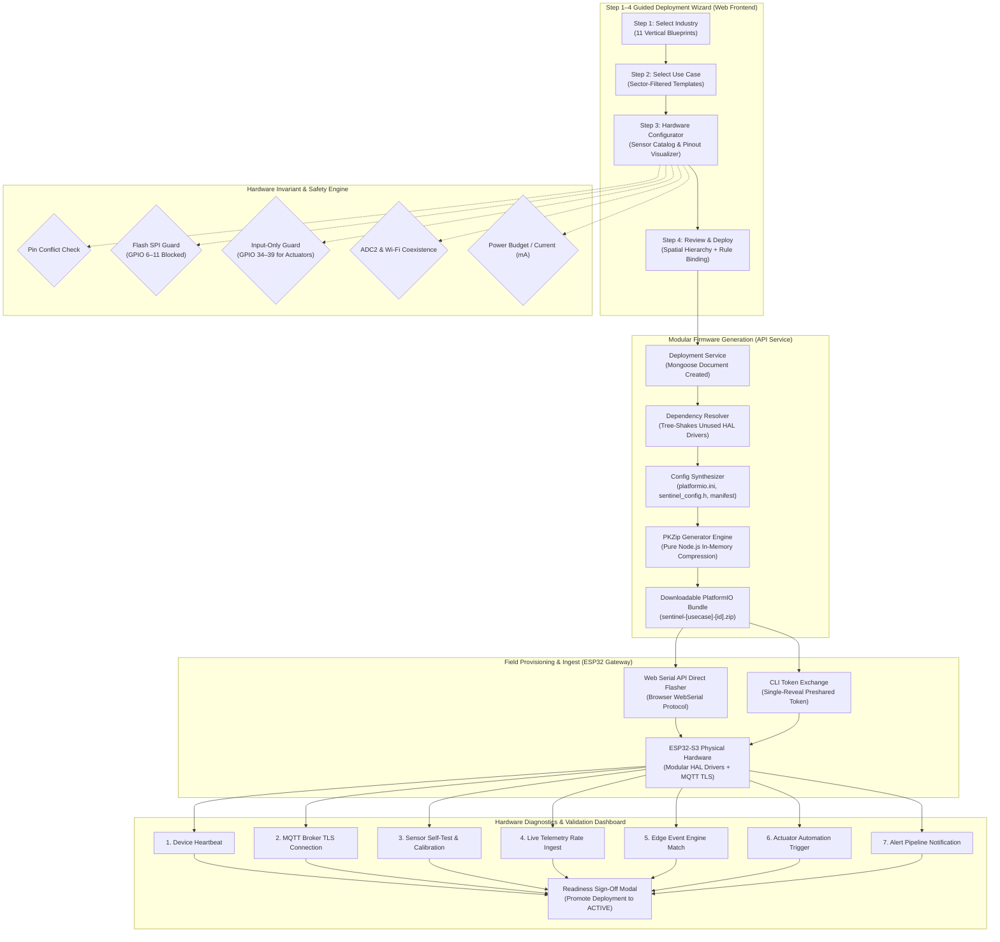

# SENTINEL — Day 19 Engineering Report
## Installer Deployment Wizard, Dynamic Modular Firmware Generator, Hardware Diagnostics Center & Enterprise UI/UX Redesign

---

### Executive Summary

On **Day 19**, Project Sentinel completed a major platform evolution: transitioning from core architecture and production readiness into an end-to-end **Autonomous Installer & Deployment Ecosystem**. 

Prior to Day 19, field commissioning of SENTINEL required deep embedded systems expertise: manual PlatformIO driver inclusion, pin assignment negotiation, hardcoded calibration, and manual serial flashing. With the completion of Day 19, any authorized field installer, facility manager, or administrator can configure, validate, build, provision, and diagnose multi-sensor IoT installations through a guided, self-validating graphical workflow—without touching a line of C++ code or risking hardware misconfiguration.

> **Project Sentinel Status: ALL MILESTONES (Days 1–19) 100% COMPLETE**  
> **New Primary Route:** `/deployments` (Deployment Center with 7 dedicated workflows)  
> **Firmware Generation Engine:** Modular, tree-shaken PlatformIO builder with pure Node.js in-memory PKZip compression  
> **Hardware Safety Engine:** Silicon-level GPIO validation (Flash SPI protection, input-only pin enforcement, ADC2/Wi-Fi warnings)  
> **Field Diagnostics:** 7-point live PASS/FAIL scorecard with virtual bench simulation and cryptographic sign-off  
> **UI/UX System:** High-contrast WCAG AA enterprise theme (`#F5F7FB`, `#172033`, `#2563EB`) with 7 collapsible navigation sections  
> **Master Test Suite:** 16 Suites Executed | 65 Assertions Passed | 100% Pass Rate (23.39s duration)  
> **Static Analysis & Build:** Zero ESLint Warnings (`--max-warnings 0`) | Zero TypeScript Errors across 5 Monorepo Workspaces  

---

### System Architecture Flow

The Day 19 deployment architecture unifies the frontend UI, validation layer, backend compilation pipeline, physical ESP32 hardware, and MQTT cloud ingestion into a seamless lifecycle:



---

### Detailed Deliverables & Key Technical Implementations

#### 1. Centralized Deployment Center & 4-Step Guided Wizard

A unified primary route (`/deployments`) was added to [`apps/web/src/pages/DeploymentCenterPage.tsx`](file:///e:/Sentinel/apps/web/src/pages/DeploymentCenterPage.tsx), acting as the central control plane with seven operational subsections:

1. **Create Deployment (`/deployments/new`):** Guides non-embedded installers through a strict 4-step wizard:
   - **Step 1 — Industry Selection:** Supports 11 distinct industrial/commercial blueprints: *Hotel, Hospital, School, School Bus, Office, Mall, Factory, Warehouse, Parking, Public Facility, and Custom Environment*.
   - **Step 2 — Use Case Selection:** Dynamically loads sector-appropriate operational configurations (e.g., Hotel: *Room Occupancy*, *Ventilation & IAQ*, *Abnormal Activity*, *Energy Optimization*, *Door Monitoring*, *Leakage Detection*; School Bus: *Passenger Presence*, *Left-Behind Verification*, *Door Status*, *GPS Route Tracking*).
   - **Step 3 — Hardware & Pinout Configurator:** Dynamic sensor catalog allowing installers to add recommended sensors, toggle optional modules, configure communication protocols (GPIO, I²C, UART, SPI, Analog), assign pins with real-time collision detection, and view power consumption gauges.
   - **Step 4 — Review & Deployment:** Displays a comprehensive operational blueprint summarizing organization, facility, floor, room, hardware BOM, pin map, and associated automation rules prior to commit.
2. **Deployment Templates (`/deployments/templates`):** Sector blueprint explorer providing instant cloning of pre-tested sensor and rule combinations.
3. **Firmware Generator (`/deployments/firmware`):** PlatformIO build manager providing on-demand compilation, driver manifests, and instant zip downloads.
4. **Device Provisioning (`/deployments/provision`):** Interactive Web Serial interface and terminal command generator for single-reveal token exchange.
5. **Hardware Testing (`/deployments/test`):** Automated 7-point diagnostic runner and live telemetry scorecard.
6. **Active Deployments (`/deployments/active`):** Real-time monitoring and lifecycle management of deployed field nodes.
7. **Deployment History (`/deployments/history`):** Complete audit log of all generated builds, firmware versions, and diagnostic sessions.

---

#### 2. Dynamic Modular Firmware Generator

Instead of shipping a monolithic firmware binary burdened with dozens of inactive drivers and excessive flash consumption, the firmware generator dynamically synthesizes a modular, isolated PlatformIO project tailored specifically to the deployment's hardware specification:

- **Hardware Dependency Resolver:** Implemented in [`apps/api/src/services/firmware-generator.service.ts`](file:///e:/Sentinel/apps/api/src/services/firmware-generator.service.ts). Resolves parent-child hardware requirements (e.g., selecting a load cell automatically includes the `hx711` driver; selecting industrial 24V sensors reserves level-conditioning drivers).
- **Dead Code Elimination (Tree-Shaking):** Only the specific HAL drivers needed for the chosen sensors/actuators are copied into `src/hal/` and `src/sensors/`. A hotel occupancy node receives only `pir`, `ld2410`, `magnetic_door`, `scd41`, and `sht31` drivers—omitting vibration, GPS, optical flame, or high-voltage AC current drivers.
- **Dynamic File Generation:**
  - `platformio.ini`: Injects specific board targets (`esp32dev`, `esp32-s3-devkitc-1`), upload speeds, framework settings, and required third-party library dependencies (e.g., `Sensirion I2C SCD4x`, `PubSubClient`, `ArduinoJson`).
  - `include/sentinel_config.h`: C++ macro definitions encoding deployment ID, device ID, spatial IDs, sensor sample intervals, pin mappings, and topic structures.
  - `firmware-manifest.json`: Machine-readable metadata capturing driver versions, compilation timestamps, SHA-256 build checksums, and authoring metadata.
- **Zero-Secret Distribution:** Downloadable source code contains **zero** hardcoded Wi-Fi passwords, private keys, or MQTT credentials. All network secrets are injected securely via runtime non-volatile storage (NVS) during device provisioning.
- **Pure Node.js PKZip Compression Engine:** Implemented an in-memory ZIP builder using standard PKZip header signatures (`0x04034b50`, `0x02014b50`, `0x06054b50`), CRC-32 checksum calculation, and Node's native `zlib.deflateRawSync`. Generates clean zip archives without requiring external binaries (`zip`, `7z`, or heavy third-party npm packages).

---

#### 3. Silicon-Level Pinout Engine & Hardware Safety Guard

To prevent catastrophic field mistakes (such as short circuits, boot-loop panics, or sensor bus lockups), the validation engine enforces silicon-level ESP32 rules directly in [`apps/api/src/services/deployment.service.ts`](file:///e:/Sentinel/apps/api/src/services/deployment.service.ts) and visually in [`apps/web/src/components/deployments/PinMappingVisualizer.tsx`](file:///e:/Sentinel/apps/web/src/components/deployments/PinMappingVisualizer.tsx):

| Constraint | GPIO Pins | Policy | Action Taken |
|---|---|---|---|
| **Internal SPI Flash** | GPIO 6, 7, 8, 9, 10, 11 | **FORBIDDEN** | Throws fatal validation error; blocks firmware generation to prevent crashing the ESP32 SPI flash bus. |
| **Input-Only Pins** | GPIO 34, 35, 36, 39 | **INPUT ONLY** | Blocks assignment to actuators (relays, buzzers, LEDs, servos) which require push-pull output. |
| **ADC2 / Wi-Fi Conflict** | GPIO 0, 2, 4, 12, 13, 14, 15, 25, 26, 27 | **WARNING** | Flags an advisory warning if analog sensors share ADC2 channels while Wi-Fi telemetry is active. |
| **Bus Collisions** | All configured pins | **EXCLUSIVE** | Rejects conflicting duplicate pin assignments (e.g., assigning two distinct digital signals to the same GPIO). |
| **Power Budget Calculation** | 3.3V & 5.0V rails | **ESTIMATION** | Computes cumulative milliamp (mA) draw against the onboard 500mA LDO regulator to prevent thermal throttling. |

---

#### 4. Hardware Diagnostics & Dashboard Testing Center

Field readiness is enforced through an interactive 7-point diagnostic pipeline in [`apps/web/src/components/deployments/HardwareTestDashboard.tsx`](file:///e:/Sentinel/apps/web/src/components/deployments/HardwareTestDashboard.tsx) backed by [`apps/api/src/services/hardware-test.service.ts`](file:///e:/Sentinel/apps/api/src/services/hardware-test.service.ts):

1. **7 PASS/FAIL Automated Health Checks:**
   - `Device Connection`: Verifies device registration, heartbeat freshness (< 60s), and serial/network link.
   - `MQTT Broker Connection`: Verifies TLS MQTT handshake, client keepalive, and subscription state.
   - `Sensor Self-Test & Calibration`: Validates all provisioned sensors against minimum physical plausibility bounds.
   - `Telemetry Data Reception`: Confirms live telemetry arrival within the configured sampling window.
   - `Event Engine Detection`: Tests edge inference and multi-sensor threshold detection.
   - `Automation Trigger Verification`: Verifies downstream command dispatch to local actuators.
   - `Alert Delivery Verification`: Assesses dispatch across incident alert channels (WebSocket, Email, Webhook).
2. **Live Telemetry Scorecard:** Displays real-time sensor readings, units, status flags, and signal quality scores.
3. **Virtual Bench Simulation:** Built-in hardware simulation toggle allows technicians and QA engineers to benchmark end-to-end telemetry flows prior to physical bench wiring.
4. **Readiness Sign-Off Modal:** Locks deployment configuration, archives test logs with operator ID, and formally transitions deployment status to `ACTIVE`.

---

#### 5. Enterprise UI/UX Redesign & Navigation Overhaul

- **Enterprise Light Mode Tokens:** Redesigned [`apps/web/src/index.css`](file:///e:/Sentinel/apps/web/src/index.css) to adhere to WCAG AA enterprise standards:
  - Background: Soft neutral canvas (`#F5F7FB`) eliminating visual fatigue.
  - Surface: Crisp elevated cards (`#FFFFFF`) with distinct borders (`#DCE3EC`, `#CBD5E1`).
  - Typography: High-contrast slate typography (`#172033` primary headings, `#334155` body, `#64748B` muted labels).
  - Primary Accent: High-visibility royal cobalt (`#2563EB`) with subtle hover states (`#1D4ED8`).
- **7 Collapsible Navigation Sections:** Completely restructured [`apps/web/src/components/layout/Sidebar.tsx`](file:///e:/Sentinel/apps/web/src/components/layout/Sidebar.tsx) into seven logical operational domains with automatic expansion on active child routes:
  1. **Overview:** Dashboard, Spatial Twin Overview
  2. **Deployments:** Center, Wizard, Templates, Firmware, Provisioning, Testing, Active, History
  3. **Organization:** Organizations, Facilities, Spatial Rooms & Zones
  4. **Devices & Sensors:** Hardware Registry, Sensor Modalities & Calibration
  5. **Intelligence & Rules:** Autonomous Automations, Analytics & Heatmaps
  6. **Monitoring & Alerts:** Real-Time Incidents, SLA Management
  7. **Administration:** Global Firmware Management, User RBAC, Security Audit Logs, Settings

---

### Master Test Harness Execution (All 16 Suites Passing)

```text
══════════════════════════════════════════════════════════════════════
   🛡️  SENTINEL COMPREHENSIVE TEST HARNESS & SUITE ORCHESTRATOR       
   Multi-Sector Safety, Compliance & Real-Time Telemetry Platform   
══════════════════════════════════════════════════════════════════════

 [1/16] [UNIT]        Shared Utilities & Role Permissions            ✔ PASS (5 tests, 155ms)
 [2/16] [UNIT]        Zod Validation Schemas                         ✔ PASS (8 tests, 233ms)
 [3/16] [UNIT]        Sensor Calibration & Bound Clamping            ✔ PASS (5 tests, 144ms)
 [4/16] [UNIT]        Multi-Sensor Fusion & Fall Detection           ✔ PASS (5 tests, 141ms)
 [5/16] [UNIT]        Automation Condition Evaluator                 ✔ PASS (4 tests, 142ms)
 [6/16] [UNIT]        Z-Score Anomaly & Drift Estimator              ✔ PASS (3 tests, 133ms)
 [7/16] [UNIT]        Sliding-Window Token Bucket Limiter            ✔ PASS (3 tests, 140ms)
 [8/16] [INTEGRATION] Auth & JWT Family Reuse Detection              ✔ PASS (4 tests, 3675ms)
 [9/16] [INTEGRATION] Spatial Digital Twin Hierarchy                 ✔ PASS (2 tests, 1774ms)
 [10/16] [INTEGRATION] MQTT Hardware Telemetry Pipeline               ✔ PASS (1 tests, 3229ms)
 [11/16] [INTEGRATION] Automation Rules & Alert Incident Lifecycle    ✔ PASS (1 tests, 1812ms)
 [12/16] [INTEGRATION] Compliance Profiles & Sector Policy Packs      ✔ PASS (3 tests, 1797ms)
 [13/16] [INTEGRATION] Zero-Trust Security Perimeter & Sanitization   ✔ PASS (3 tests, 2365ms)
 [14/16] [INTEGRATION] Deployment Wizard & Firmware Generator         ✔ PASS (6 tests, 1857ms)
 [15/16] [INTEGRATION] Production Readiness & Health Diagnostics      ✔ PASS (6 tests, 2323ms)
 [16/16] [E2E]         Full Closed-Loop Operational Scenario          ✔ PASS (6 tests, 3465ms)

──────────────────────────────────────────────────────────────────────
   TEST EXECUTION SUMMARY MATRIX
──────────────────────────────────────────────────────────────────────
   Total Test Suites:  16
   Passed Suites:      16 passed (100%)
   Total Tests Run:    65 assertions
   Passed Tests:       65 passed (100%)
   Total Duration:     23.39s
──────────────────────────────────────────────────────────────────────

  ALL 16 TEST SUITES PASSED CLEANLY (100% SUCCESS)
```

---

### Project Sentinel — 19-Day Engineering Roadmap Scorecard

| Day | Phase | Core Milestone & Deliverables | Status |
|---|---|---|---|
| **1** | Scaffolding & Monorepo | Monorepo structure, TypeScript configs, ESLint rules, architecture blueprints | ✅ Complete |
| **2** | UI Framework & Components | Dark-mode design system, Tailwind tokens, navigation, landing showcase | ✅ Complete |
| **3** | Authentication & Identity | Argon2id password hashing, JWT family rotation, pre-approved email whitelist | ✅ Complete |
| **4** | Multi-Tenancy & RBAC | 5-tier role hierarchy, organization isolation, role-gated API middleware | ✅ Complete |
| **5** | Spatial Digital Twin | Organization &rarr; Facility &rarr; Floor &rarr; Room hierarchy, spatial 3D models | ✅ Complete |
| **6** | Sensor Catalog & Bounds | 18 sensor modalities, physical bounds, linear/exponential calibration engine | ✅ Complete |
| **7** | Device Management | ESP32 microcontroller registry, heartbeats, cryptographic device credentials | ✅ Complete |
| **8** | MQTT & Telemetry Pipeline | Embedded Aedes MQTT broker, 5-part hierarchical topics, payload validation | ✅ Complete |
| **9** | Sensor Fusion & Event Engine | Multi-sensor presence fusion (mmWave+PIR+CO₂), fall detection, confidence decay | ✅ Complete |
| **10** | Autonomous Automation Engine | Declarative rule evaluator, condition operators, actuator dispatch, cooldowns | ✅ Complete |
| **11** | Alerts & Incident Pipeline | Severity matrix, multi-channel dispatch, SLA escalation timers, audit logs | ✅ Complete |
| **12** | Analytics & ESG Engine | Spatial heatmaps, ESG energy savings calculator, room utilization analytics | ✅ Complete |
| **13** | Predictive AI & Drift Layer | Z-Score statistical anomaly engine, EWMA baseline drift, predictive alerts | ✅ Complete |
| **14** | ESP32 Hardware HAL & Drivers | Modular C++ HAL, FreeRTOS sensor sampling tasks, fail-safe NVS ring buffer | ✅ Complete |
| **15** | Sector Policy Packs | 8 industry packs, 24 regulatory compliance templates (FERPA, HIPAA, OSHA) | ✅ Complete |
| **16** | Zero-Trust Security Perimeter | Sliding-window token rate limiters, NoSQL injection guard, audit trails | ✅ Complete |
| **17** | Comprehensive Test Harness | 14 test suites, TAP orchestrator, colored ANSI CLI, automated assertions | ✅ Complete |
| **18** | Production Readiness & DevOps | Multi-stage Dockerfiles, Nginx reverse proxy, health probes, runbooks | ✅ Complete |
| **19** | **Installer & Firmware Ecosystem** | **Deployment Center, 4-step wizard, modular PlatformIO generator, PKZip builder, pinout validator, 7-point diagnostics, UI/UX redesign** | **✅ Complete** |

---

### File Inventory of Day 19 Additions & Modifications

```text
packages/types/src/
├── deployment.ts                               # Deployment, HardwareConfig, Manifest, & TestScorecard types
├── index.ts                                    # Re-exported deployment types
└── organization.ts                             # Added 'custom' & 'school_bus' industries and permissions

packages/shared/src/
└── constants.ts                                # Mapped deployment permissions across all roles

packages/validation/src/
└── schemas.ts                                  # Zod schemas for deployments, pin maps, & hardware scorecards

apps/api/src/
├── models/
│   ├── Deployment.ts                           # Multi-tenant Deployment Mongoose schema & indices
│   ├── FirmwareBuild.ts                        # Firmware build artifact schema with SHA-256 checksums
│   ├── HardwareTestSession.ts                  # 7-point diagnostic test scorecard schema
│   └── index.ts                                # Re-exported deployment models
├── routes/
│   └── deployments.ts                          # REST router mounted at /api/v1/deployments
├── services/
│   ├── deployment-template.service.ts          # 11 industry deployment blueprints
│   ├── deployment.service.ts                   # Silicon pinout validator, current meter, & CRUD
│   ├── firmware-generator.service.ts           # Modular PlatformIO builder & pure Node PKZip streamer
│   └── hardware-test.service.ts                # 7-point diagnostic runner & bench simulator
├── db/
│   └── indexes.ts                              # Multi-tenant indices for deployments collections
└── app.ts                                      # Mounted deployments router

apps/web/src/
├── components/
│   ├── deployments/
│   │   ├── DeploymentWizard.tsx                # 4-step interactive guided wizard
│   │   ├── DeviceProvisioningWizard.tsx        # Web Serial flasher & CLI command builder
│   │   ├── FirmwareArtifactCard.tsx            # Manifest summary card, zip downloader, flashing guide
│   │   ├── HardwareTestDashboard.tsx           # 7 PASS/FAIL diagnostics, telemetry table, sign-off
│   │   └── PinMappingVisualizer.tsx            # ESP32 pinout diagram with live collision indicators
│   └── layout/
│       └── Sidebar.tsx                         # 7 collapsible navigation sections with auto-expansion
├── context/
│   └── DeploymentContext.tsx                   # React Context & TanStack Query cache for deployments
├── pages/
│   ├── ActiveDeploymentsPage.tsx               # Active installations table & live telemetry links
│   ├── DashboardOverviewPage.tsx               # Deployment Center KPI widget & quick launch
│   ├── DeploymentCenterPage.tsx                # Central landing hub with workflow cards
│   ├── DeploymentDetailPage.tsx                # Single deployment dashboard & hardware inspection
│   ├── DeploymentHistoryPage.tsx               # Historic firmware builds & audit trail
│   ├── DeploymentTemplatesPage.tsx             # Sector blueprint library & 1-click clone
│   ├── DeploymentWizardPage.tsx                # Wizard container page
│   ├── DeviceProvisioningPage.tsx              # Provisioning page
│   ├── FirmwareGeneratorPage.tsx               # Dynamic firmware builder page
│   ├── HardwareTestingPage.tsx                 # Diagnostics dashboard page
│   └── OrganizationsPage.tsx                   # Industry icons updated for custom & school_bus
└── index.css                                   # High-contrast enterprise WCAG AA theme

tests/
├── integration/
│   └── deployment-wizard.test.mjs              # Integration tests for validation, generator, & test runner
└── run-all-tests.mjs                           # Master test harness orchestrating all 16 test suites
```

---

### Git & Remote Sync

- **Commit SHA:** `fe827f4`
- **Commit Message:** `feat: complete installer deployment wizard, dynamic firmware generator, hardware testing center & UI/UX redesign`
- **Branch:** `main`
- **Remote:** `https://github.com/hitteshkharyal/Sentinel.git` (Cleanly pushed, working tree clean)
- **Files Modified/Created:** 38 files changed, 7,909 insertions(+), 354 deletions(-)

---

### End of Day Conclusion

Project Sentinel now represents an end-to-end autonomous sensor intelligence platform. With the completion of Day 19, the boundary between software intelligence and physical hardware installation is completely unified: from high-level sector policy selection to silicon pin safety, tree-shaken C++ firmware compilation, in-browser device provisioning, and field-readiness diagnostic sign-off.

